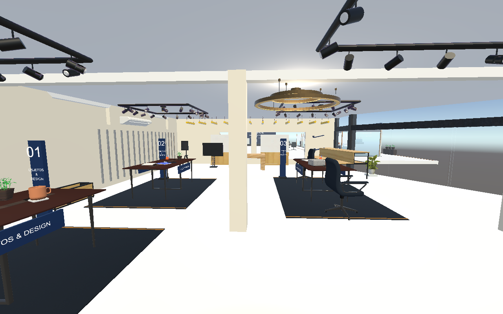
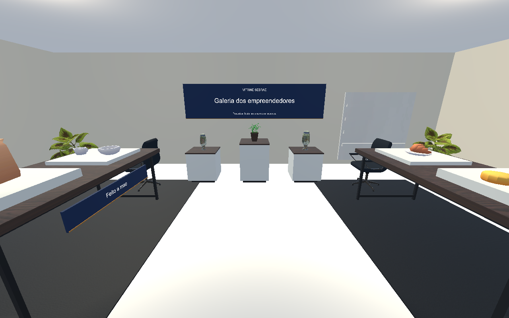
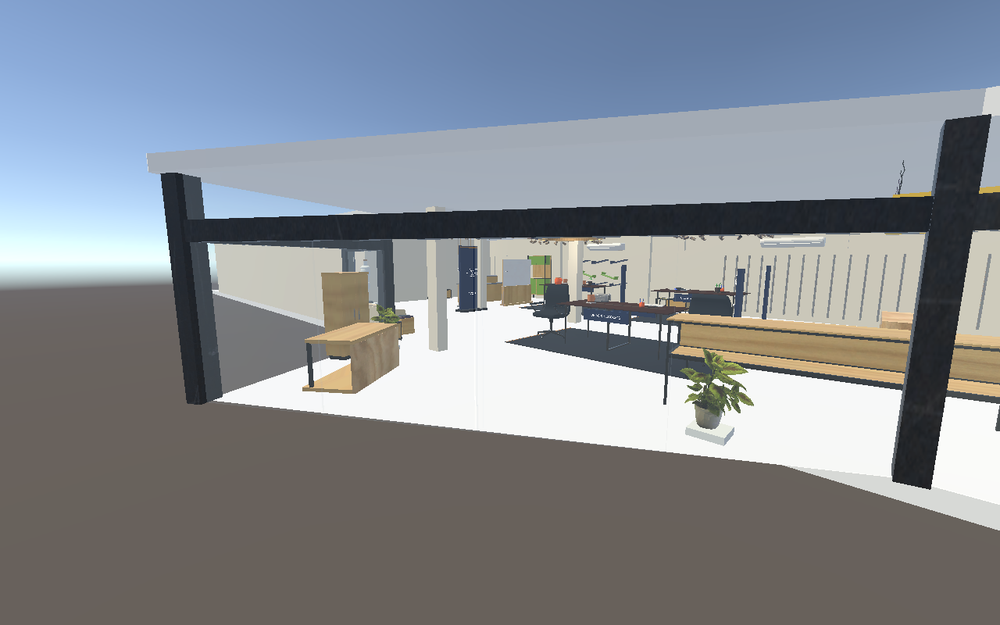
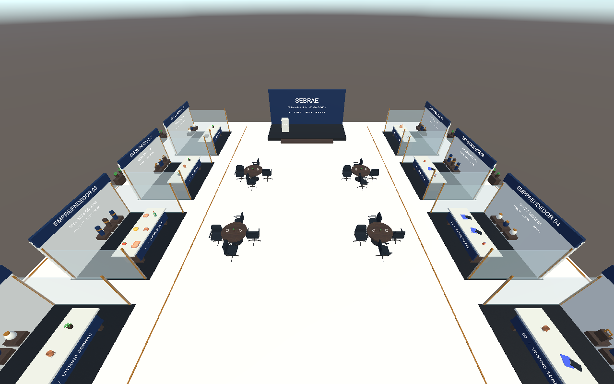

# Vitrine Sebrae VR — EXPLORALAB

Projeto Unity para apresentar produtos de empreendedores em uma vitrine digital, com salas de exposição, espaços de atendimento e pavilhão para eventos.

## Abrir o projeto

1. Use o Unity Hub com o editor **Unity 6.0 — 6000.0.83f1**.
2. Abra a pasta **SebraeLabVR** como projeto Unity e aguarde a importação dos pacotes e assets.
3. Abra **Assets/Scenes/Sebrae.unity**, a primeira cena habilitada no build. A cena **MostruarioSebrae.unity** também contém a montagem.
4. No menu **SebraeLab > Mostruario**, use os comandos para localizar as salas, o pavilhão e o paisagismo.

## Montagem

- Salão com expositores organizados por coleção e vitrine de moda.
- Três salas com quatro mesas de exposição e oito cadeiras.
- Pavilhão com oito stands individuais, quatro mesas de encontro e palco.
- Paisagismo na entrada e nas galerias.
- Piso branco, paredes em creme pastel e identidade visual em azul, madeira e tons neutros.
- Lustre de dois aros, focos de destaque e materiais compatíveis com URP.
- Configuração de XR/OpenXR e áreas de teleporte existentes no projeto.

Os produtos e nomes usados na montagem são amostras cenográficas. A importação, a aparência e as referências foram conferidas no editor; a experiência no headset ainda precisa ser testada no aparelho de destino.

## Imagens do projeto









## Arquivos e créditos

O projeto inclui os assets finais necessários para abrir as cenas. Caches do Unity, downloads originais, backups locais e arquivos temporários não são versionados.

- [Instruções e histórico da montagem](SebraeLabVR/MOSTRUARIO.md)
- [Assets baixados e aplicados](SebraeLabVR/ASSETS-BAIXADOS.md)
- [Créditos dos modelos Artec 3D — CC BY 4.0](SebraeLabVR/Assets/Mostruario/ArtecCollection/CREDITS.md)
- [Licença dos modelos Kenney usados na coleção de produtos](SebraeLabVR/Assets/Mostruario/FoodKit/License.txt)
- [Fontes para novos objetos e texturas](SebraeLabVR/ASSETS-PARA-VITRINE.md)

A coleção Artec inclui modelos adaptados de **Houseplant** e **Decorative vase**, com créditos também na sinalização da vitrine. Os materiais e modelos de outros fornecedores mantêm suas licenças nas respectivas pastas.

## Verificação e ferramentas

Depois de importar o projeto pelo Unity, com Node.js 22 ou superior instalado, execute a partir da raiz do repositório:

```powershell
node SebraeLabVR/Tools/validate-elegance.mjs
node SebraeLabVR/Tools/validate-exterior.mjs
```

As ferramentas em **SebraeLabVR/Tools** registram as posições e permitem regenerar a montagem. Elas sobrescrevem elementos gerados; preserve adaptações manuais em uma cópia da cena antes de executá-las. Os scripts de preparação a partir de fontes externas exigem os downloads originais e, quando indicado, o Blender; esses arquivos de download ficam fora do Git.

Repositorio do paper da disciplina de Tecnologias Emergentes, 5º período.